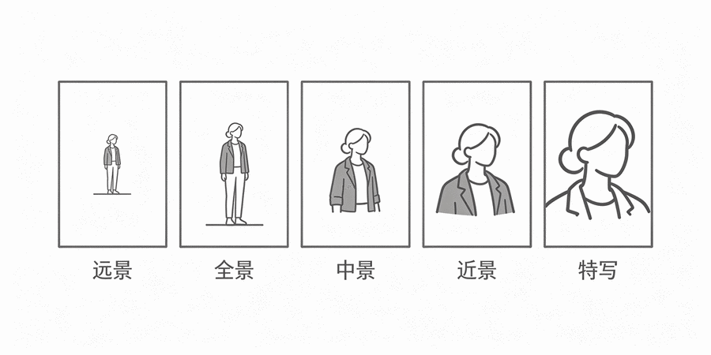

# 平视机位

## 先说问题

"平视机位平平无奇，不拍远全中景"——原笔记这句结论过于绝对，也和《拍摄机位》里"中机位拍全身最自然"矛盾。

平视不是"没特点"，而是**最接近人眼观看方式的机位**。它的价值在"真实"和"情绪",难点在"如何不平"。这一篇把景别、五官比例、15° 微调讲清楚。

## 一、机位是三个坐标

机位不是"高一点低一点"，它是相机相对模特的三维位置：

| 坐标 | 取值 | 影响 |
|---|---|---|
| 高度 | 平视 / 高机位 / 低机位 | 脸型、身高、气场 |
| 角度 | 正面 / 四分之三侧 / 侧面 / 背面 | 立体感、轮廓、故事 |
| 距离 | 远景 / 全景 / 中景 / 近景 / 特写 | 景别、透视、亲密感 |

**平视 = 高度与模特眼睛齐平**，角度和距离仍可自由组合。所以"平视"从来不等于"只能拍特写"。

## 二、景别五档：远、全、中、近、特

| 景别 | 取景范围 | 画面重点 | 适合 |
|---|---|---|---|
| 远景 | 人物很小，环境为主 | 空间、气势、人在天地间 | 旅行、风光人像、交代环境 |
| 全景 | 全身完整入镜 | 体态、衣着、人与环境关系 | 全身人像、时尚、纪实 |
| 中景 | 膝盖或腰部以上 | 动作、姿态、半身关系 | 半身人像、街拍、互动 |
| 近景 | 胸部以上 | 表情、眼神、情绪 | 情绪人像、访谈 |
| 特写 | 肩部以上或面部局部 | 五官、皮肤、细节 | 美妆、情绪、产品脸 |

原笔记"特写：错误 / 近景：错误 / 中景：错误"是残缺的提纲，实际每种景别都有成立的条件，关键在**机位高度与景别匹配**：

- 特写 + 平视 → 最自然，五官不变形；
- 近景 + 平视 → 情绪直接，适合对话感；
- 中景 + 平视 → 真实，但容易"证件照感"，需要靠环境/动作破；
- 全景 + 平视 → 比例真实，腿不拉长，适合纪实；
- 远景 + 平视 → 人在环境里，适合交代故事。

## 三、五官比例：三庭五眼

判断"平视拍出来像不像本人"，看两个比例：

**三庭**：发际线 → 眉心 → 鼻底 → 下巴尖，三段应大致相等（1:1:1）。

- 上庭偏长：额头高，平视会显额头大，可略俯 10°–15°；
- 中庭偏长：显成熟，平视最稳；
- 下庭偏短：显幼态，略仰会强调下巴，慎用。

**五眼**：脸的宽度约等于五只眼睛的宽度，两眼间距约一只眼宽。

- 眼距偏宽：正面平视最明显，可转 3/4 侧；
- 眼距偏窄：正面平视会显局促，可略侧 + 微俯。

这些比例不是"标准美"，而是**判断机位会不会放大缺点的参照系**。

## 四、平视的优缺点

**优势：**

1. 真实感强——证件照、肖像、纪实、人文；
2. 情绪直接——近景/特写时，观者像在与人对话；
3. 五官不变形——最接近人眼视角。

**劣势：**

1. 容易平——缺少透视张力，背景和人物容易"贴"在一起；
2. 不显高、不显瘦——全身平视比例真实，但没有"长腿"效果；
3. 对背景要求高——没有透视压缩，背景杂物全入镜。

所以平视要"不平"，靠的是：**光线（侧光/轮廓光）、景深（虚化背景）、角度（3/4 侧）、动作（走动/回头）、道具**。

## 五、15° 微调：平视的"选择题"

严格平视太硬，实战常在 ±15° 内微调：

| 方向 | 效果 | 适合 |
|---|---|---|
| 高 15° | 额头受光、下颌收窄、显脸小 | 甜美、日系、圆脸 |
| 严格平视 | 比例真实、五官不变 | 证件、纪实、商务 |
| 低 15° | 下颌线突出、气场强、显腿长 | 欧美、男性、时尚 |

判断用哪边：

- **风格**：甜美 → 高 15°；欧美/硬照 → 低 15°；
- **情绪**：开怀大笑 → 略高，容易共鸣；冷峻 → 略低，压出气场；
- **五官**：额头高 → 低 15°（相机略低，额头后退）；下巴短 → 高 15°（下巴前伸）。

## 六、规避"近大远小"

平视时，离镜头近的部分会被放大：

- 额头高的人，平视会让额头更突出 → 相机略低、略俯，让额头后退；
- 鼻子挺的人，正面平视会放大鼻头 → 转 3/4 侧；
- 脸宽的人，正面平视会显宽 → 侧 15°–30°。

核心仍是那句：**透视只由距离决定，角度只是改变"哪部分离镜头更近"。**

## 七、平视实战建议

1. **不要只用平视拍证件照**：加侧光、加环境、加动作，平视也能有氛围；
2. **全身平视找环境**：平视全身最真实，但需要背景有层次（街道、门框、纵深）；
3. **特写平视看眼睛**：对焦锁眼睛，光圈 f/2.8–f/4，留一点景深给鼻尖；
4. **3/4 侧是万能角度**：比正面立体，比侧面自然，适合大多数脸型。

## 要点回顾

- 平视 = 高度与眼齐平，角度和距离仍可组合。
- 景别五档各有成立条件，不是"平视只能拍特写"。
- 三庭五眼用来判断机位会不会放大缺点。
- ±15° 微调是平视的"选择题"，按风格/情绪/五官选。

> 参考：伯里曼《人体结构》；《人像摄影》三庭五眼章节。
