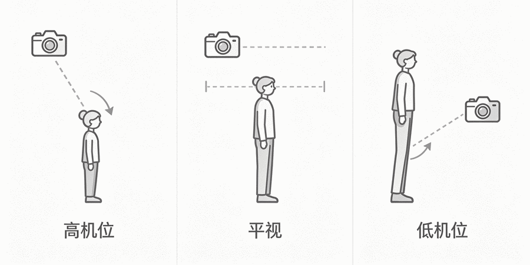

# 拍摄机位

## 先说问题

"高机位显脸小、低机位显腿长"这两句人人会背，但实战里高机位常把人拍成"大头娃娃"，低机位常拍出"鼻孔照"。

机位不是一个"高低"开关，而是**高度、角度、距离**三个坐标的组合；同一个高度，配不同景别，效果完全相反。

## 一、三种机位的基本效果

| 机位 | 定义（相对被摄者眼睛） | 画面感受 | 典型用途 |
|---|---|---|---|
| 高机位 | 相机高于眼睛，向下俯拍 | 显脸小、压缩空间、可爱/脆弱 | 半身、坐姿、俯拍特写 |
| 中机位（平视） | 相机与眼睛齐平 | 自然、真实、亲切 | 纪实、证件、对话感 |
| 低机位 | 相机低于眼睛，向上仰拍 | 显高、气场强、腿长 | 全身、时尚、男性硬照 |

再加两个维度：

- **角度**：正面（庄重）、3/4 侧（立体）、侧面（轮廓）、背面（故事）；
- **距离**：远景 → 特写，决定景别和透视强度。

## 二、机位 × 景别对照表

| 机位 | 景别 | 效果 | 适合 |
|---|---|---|---|
| 低机位 | 全身 | 腿长、身材拉伸、气场强 | 时尚大片、男性硬照 |
| 低机位 | 半身 | 下颌线突出、显霸气，脸略大 | 男性、力量感 |
| 低机位 | 特写 | 仰拍放大下巴鼻孔，易变形 | 一般不用，除非要压迫感 |
| 中机位 | 全身 | 比例真实，腿不拉长 | 写实、生活纪实 |
| 中机位 | 半身 | 最自然，五官比例正常 | 日常人像、证件照 |
| 中机位 | 特写 | 最标准的人像方式 | 头像、商务、婚纱 |
| 高机位 | 全身 | 人显矮、腿缩短 | 特殊艺术效果，慎用 |
| 高机位 | 半身 | 瘦脸、肩窄、温柔可爱 | 女生半身、甜美风 |
| 高机位 | 特写 | 萌感、乖巧、少女感 | 自拍、可爱系 |

**最重要的一条**：高机位 + 站立全身 = 显矮、显头大、比例失调。这是最常见的"新手坑"。

## 三、高机位什么时候是对的

高机位不是"不能用"，而是"不适合站立全身"：

1. **坐、躺、趴**：人物本来就低，高机位变成自然视角；
2. **半身/特写**：追求显脸小、可爱；
3. **简化背景**：以地面、床单、草地为背景，避开远处杂乱；
4. **俯拍特写**：强调眼睛、制造"被审视"的脆弱感。

## 四、低机位什么时候是对的

1. **全身拉腿**：从腰部以下往上拍，腿的透视被拉长；
2. **气场/权威**：仰拍让人显得高大、有压迫感；
3. **建筑/天空**：低机位拍高楼、树冠，强调高度；
4. **创意透视**：低机位 + 广角，制造夸张的比例。

低机位的坑：仰拍特写会放大下巴、鼻孔；广角低机位会让边缘人物变形。解决：拍全身用 24–35mm，距离拉远；拍特写别用低机位。

## 五、全身照的正确机位

- **想显高、显腿长**：低机位（相机约在腰部高度），镜头略仰，人物脚贴近画面下边缘；
- **想自然、平等**：中机位（相机在胸部到腰部之间），比例最真实；
- **想文艺、环境感**：略低 + 广角，让人物小、环境大。

口诀：**脚贴底、头留白、腿朝镜头伸。**人物一条腿向前伸、脚尖朝向镜头，低机位拉长效果最明显。

## 六、中机位特写的进阶

中机位特写没有透视戏剧性，靠这四件事撑画面：

1. **裁剪**：大胆裁掉额头以上、脖子以下，甚至只留眼睛和嘴；
2. **三分/黄金分割**：眼睛不要放正中，视线方向留白；
3. **角度**：正面庄重，3/4 侧立体，侧面有故事；
4. **光线**：侧光、轮廓光、伦勃朗光，让平淡的特写有结构；
5. **景深**：f/1.8–f/2.8 虚化背景，让人从环境里"浮"出来。

## 七、高/低机位拍特写的情绪差异

| 机位 | 情绪 | 风险 |
|---|---|---|
| 低机位仰拍 | 压迫、力量、戏剧、超现实 | 放大下巴、鼻孔 |
| 高机位俯拍 | 脆弱、依赖、可爱、"无辜大眼" | 有"被审视"的压迫感 |
| 平视 | 平等、真实、对话 | 容易平 |

## 八、机位选择的三步法

1. **先定景别**：要环境（远/全）、要关系（中）、要情绪（近/特）？
2. **再定高度**：要显高（低）、要真实（中）、要显小/可爱（高）；
3. **最后调角度**：正面稳、3/4 立体、侧面有故事。

不要反过来"先站好再想拍什么"，机位是为表达服务的。

## 要点回顾

- 机位 = 高度 + 角度 + 距离，三者组合决定效果。
- 高机位适合半身/坐躺，不适合站立全身。
- 低机位适合全身拉腿，不适合特写。
- 中机位最自然，特写靠光线和裁剪出彩。

> 参考：Michael Freeman《The Photographer's Eye》；《人像摄影摆姿与机位》。
