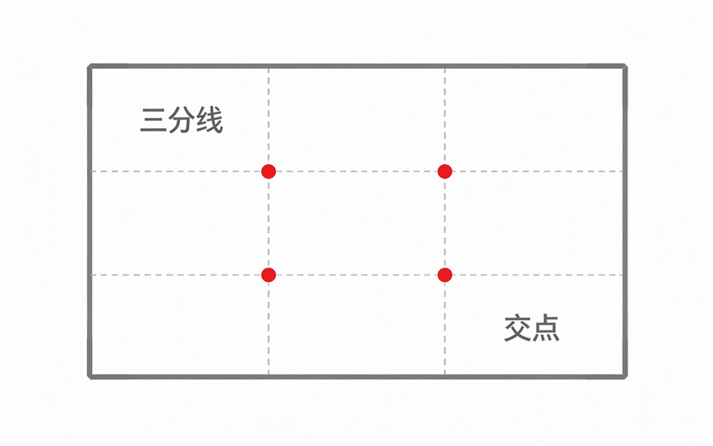

# 构图方法

## 先说问题

新手学构图，通常从"三分法"开始，然后被告知"主体放交点"。但拍出来要么死板，要么失衡。原因是：**构图法不是公式，而是"把视线往哪里引"的工具**，每种工具解决的是不同问题。

原来的笔记里有一段把"曝光效应"当成构图原理，逻辑是错的，这里先纠正，再讲方法。

## 一、先纠正一个概念：曝光效应不是"看习惯了就美"

心理学里的曝光效应（Mere Exposure Effect，Zajonc 1968）指：**人们对反复接触过的事物会产生偏好**。它解释的是"熟悉感带来好感"，不是"黄金分割让人觉美"。

黄金分割（约 1:1.618）之所以被大量使用，更合理的解释是：

- 它在数学上与自然界的生长比例（叶片排列、人体比例）有对应；
- 它接近人眼快速扫视时的"加工流畅性"（processing fluency），看起来"顺"；
- 它是文化传统与训练的结果，不是天生的生物本能。

所以正确的态度是：**黄金分割/三分法是有效的经验工具，但不是"美"的物理定律。**知道它为什么好用，比背"必须放交点"更有用。

## 二、六种常用构图法，各解决什么问题

| 方法 | 解决什么 | 怎么用 | 什么时候别用 |
|---|---|---|---|
| 三分法 | 画面呆板、主体居中太闷 | 主体放 1/3 线或交点，地平线放上/下 1/3 | 主体极简、需要绝对对称时 |
| 中心构图 | 主体孤立、重量感失衡 | 主体放正中，四周留白均衡 | 背景杂乱、主体小 |
| 对称构图 | 画面不稳定、缺少仪式感 | 中轴线对称，建筑/倒影/门框 | 想表达动感、随意时 |
| 引导线 | 视线没有落点、纵深不足 | 用道路、栏杆、光影把视线引向主体 | 线条指向画面外 |
| 框架构图 | 主体被环境淹没 | 用门、窗、树枝做"画中画" | 框架比主体还抢眼 |
| 留白 | 画面拥挤、情绪压抑 | 主体占小面积，大面积干净背景 | 需要表现细节、信息量时 |

### 1. 三分法（Rule of Thirds）

把画面横竖各分三等，四条线四个交点。主体放在交点或线上，地平线放在上 1/3 或下 1/3。

- 好处：比居中更有张力，给视线留出"走向"；
- 变体：5:8 比例（接近黄金分割 0.618），比严格三等分更"自然"；
- 常见错误：把人物眼睛放在上 1/3 线以上，头顶留白过多；或者主体贴边，视线方向没有空间。

### 2. 中心构图

主体放正中，靠对称和留白取得平衡。

- 适合：主体本身有强烈形式感（一朵花、一个产品、一张脸）、背景是纯色或虚化；
- 原理：画面大部分是均一色调时，主体放中间才有"重量感"；放偏了，重量集中一侧，观者会觉得失衡；
- 不适合：背景有杂乱元素时，中心构图会让杂乱和主体"打架"。

### 3. 对称构图

以中轴线为镜面，左右（或上下）呼应。

- 适合：建筑、倒影、走廊、舞台、宗教空间；
- 关键：对称要"准"，差一点就显得别扭；可以用网格线辅助；
- 变体：破对称——在对称画面里放一个不对称元素（一个人、一束光），画面立刻有故事。

### 4. 引导线

用画面里的线条（道路、河流、栏杆、影子、光束）把视线从边缘引向主体。

- 关键：线条要指向主体，不能指向画面外；
- 汇聚线（一点透视）比平行线更有纵深；
- 曲线（S 形）比直线更柔和，适合风景、人体。

### 5. 框架构图

用前景元素（门框、窗框、树枝、拱门）把主体"框"起来。

- 作用：遮挡杂乱、增加层次、把视线锁在框内；
- 关键：框架要比主体暗或虚，否则抢戏；
- 常见于：街拍、旅行、人像"画中画"。

### 6. 留白

主体占画面小比例，其余是干净的天空、墙面、水面。

- 作用：制造呼吸感、孤独感、高级感；
- 关键：留白不是"空"，要有方向性——人物视线朝向的那一侧留白，叫"视线空间"；
- 不适合：信息密集的纪实、需要交代环境的场景。

## 三、构图的三个层次

除了"把东西放哪"，还要看三层关系：

1. **前景**：最近的元素，用来框住主体、增加纵深；
2. **中景**：主体所在，画面重心；
3. **背景**：交代环境，决定画面"干净不干净"。

判断一张照片构图成不成立，先问：**主体在第几层？前景有没有抢戏？背景有没有干扰？**三层清楚了，再用三分/对称去微调。

## 四、构图的优先级

现场拍摄时，按这个顺序决策：

1. **先定主体**：这张照片要说什么？
2. **再定背景**：背景干净吗？能不能避开杂乱？
3. **再定机位**：高度、角度、距离（见《拍摄机位》）；
4. **最后套规则**：三分、对称、引导线，用来微调，不是用来套。

反过来"先想用三分法，再找主体"最容易拍出"正确但无感"的照片。

## 五、常见构图错误

| 错误 | 表现 | 修正 |
|---|---|---|
| 主体贴边 | 人物头部/身体被裁，视线无空间 | 往中间挪，视线方向留白 |
| 背景切头 | 树枝、电线从头顶"长"出来 | 换机位或让背景虚化 |
| 地平线居中 | 天空和地面各一半，画面呆 | 天空重要放上 1/3，地面重要放下 1/3 |
| 元素太多 | 观者不知道看哪 | 做减法，去掉不必要的元素 |
| 前景抢戏 | 前景比主体亮/清晰 | 压暗前景或虚化 |

## 要点回顾

- 构图法是"引视线"的工具，不是"美"的定律。
- 曝光效应解释熟悉偏好，不是黄金分割的原理。
- 六种方法各解决不同问题，按主体/背景/机位的顺序决策。
- 先做减法，再谈规则。

> 参考：Zajonc, R. B. (1968). Attitudinal effects of mere exposure；《摄影构图学》（本·克莱门茨）。
