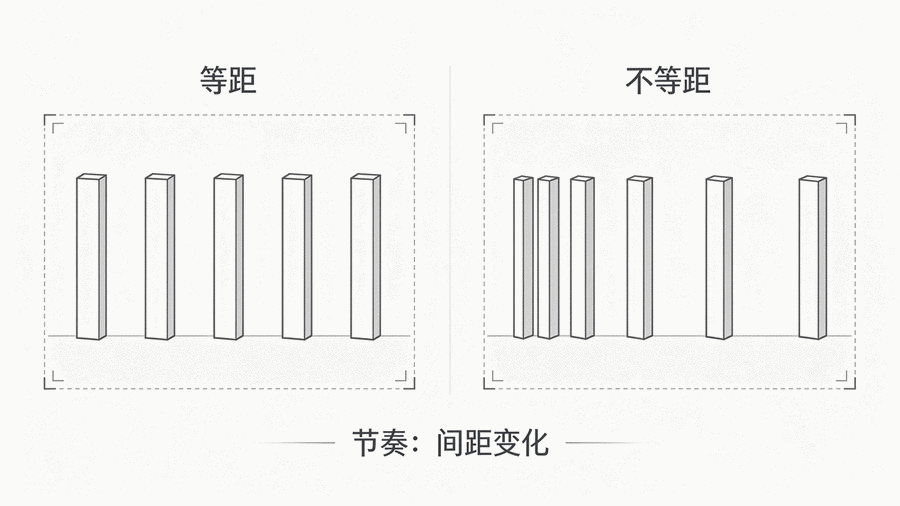

# 构图进阶：构图节奏

## 先说问题

学会了三分法、对称、引导线，照片"规矩"了，但还是"不好看"。差的那一步，往往是**节奏**——画面元素的间距、重复、明暗、密度，有没有形成"呼吸"。

节奏不是玄学，它可以拆成四个可练习的变量。

## 一、构图的两步：先搭舞台，再点睛

原笔记的"先定背景，再放人"可以扩展成三步：

1. **背景决定结构**：先把舞台摆好（线条、色块、留白）；
2. **人物决定焦点**：把主体放进舞台，成为视觉落点；
3. **光影色彩修正**：用明暗和色温微调构图或人物位置。

这三步的顺序不能反：先放人再找背景，背景永远在"迁就"人。

## 二、节奏的四个变量

### 1. 间距（Spacing）

元素之间的距离是否"有变化"。

- 等间距：整齐、秩序、偏静态（栅栏、柱廊）；
- 不等间距：有呼吸、有轻重、偏自然（树、行人、云）。

练习：找三个物体（树、灯柱、人），拍"等距"和"不等距"两版，比较哪版更自然。多数情况下，**不等距但有规律**（近密远疏）更耐看。

### 2. 重复（Repetition）

同一元素反复出现，形成韵律。

- 一排树、一排柱子、一排窗；
- 关键：不要完全居中，略微错开或让一个元素"破"掉重复，画面才有"眼"；
- 重复 + 一个异类 = 最强节奏（一排白伞里一把红伞）。

### 3. 明暗（Value Rhythm）

用光影制造"亮—暗—亮"的交替。

- 侧光/逆光下，人物一半亮一半暗，本身就是节奏；
- 前景暗、中景亮、背景暗，形成"夹心"层次；
- 明暗节奏比线条节奏更"隐性"，但更有情绪。

### 4. 密度（Density）

画面元素的疏密对比。

- 一半密集（人群、树叶）、一半空旷（天空、墙面），形成张力；
- 全密 = 压抑，全空 = 单调，密疏相间 = 呼吸；
- 人像里常用"人密、背景空"或"人小、环境密"。

## 三、节奏和"平衡"的区别

- **平衡**讲"重量"：左右、上下的视觉重量是否相当；
- **节奏**讲"变化"：元素之间的间隔、重复、明暗是否有韵律。

一张照片可以很平衡但没有节奏（对称的证件照），也可以很有节奏但不平衡（一侧密集、一侧留白）。**平衡让画面"稳"，节奏让画面"活"。**

## 四、四个练习

1. **观察间距**：同一场景拍 5 张，只改走位，让三个物体的间距不同，选最顺的一张；
2. **利用重复**：街景、树林、走廊，拍"重复元素"，故意让一个元素偏离；
3. **明暗节奏**：逆光/侧光下拍"亮—暗—亮"，人物半明半暗；
4. **看大师**：森山大道的高反差颗粒、Gregory Crewdson 的舞台式布光、王庆松的密集人群，注意他们画面里的"密度变化"。

## 五、节奏感怎么用在人像

- **人物不要正好卡在等分线上**：略偏一点，画面才有"呼吸"；
- **背景重复元素要"错位"**：一排窗、一排柱子，让人物站在其中一个的旁边，不是正中；
- **明暗要有主次**：脸最亮、背景次亮、边缘最暗，形成"亮—中—暗"的节奏；
- **留白要有方向**：视线方向留白多，背向留白少，节奏就出来了。

## 六、常见误区

| 误区 | 结果 | 修正 |
|---|---|---|
| 所有元素等距 | 呆板、像表格 | 让间距有疏密变化 |
| 重复元素完全居中 | 死板 | 错开 1/3 或让一个"破" |
| 全画面都亮 | 没有重点 | 压暗边缘/背景 |
| 全画面都满 | 压抑 | 留一块空 |
| 只追求平衡 | 稳但无趣 | 加一处不对称的"变奏" |

## 要点回顾

- 节奏 = 间距、重复、明暗、密度四个变量的变化。
- 平衡让画面稳，节奏让画面活。
- 重复 + 一个异类，是最强的节奏手法。
- 人像里，人物略偏、背景错位、明暗分层，节奏就成立。

> 参考：Michael Freeman《The Photographer's Eye》节奏章节；森山大道《犬的记忆》。
