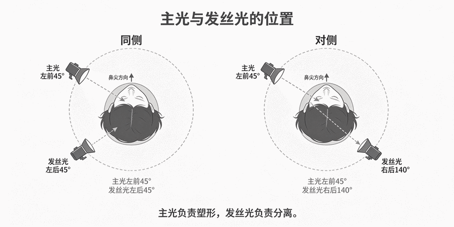

# 双灯布光

## 先说问题

只有两盏灯时，最容易出现的不是"不够亮"，而是：

- 主光和发丝光叠在一起，头顶过曝；
- 发丝光溢到脸上，把暗侧的结构冲平；
- 两盏灯色温或亮度不匹配，人物像贴了两层光。

双灯布光的全部难点，在于**给第二盏灯一个明确的职责**：它只负责"分离"，不参与"塑形"。

## 一、基础位置（先记这套）

| 灯 | 方位 | 高度 | 角度 | 亮度 |
|---|---|---|---|---|
| 主光 | 模特左前或右前 45° | 高于眼睛 20–40cm | 向下俯 30°–45° | 基准 |
| 发丝光 | 侧后方 135°–160°（对侧） | 高于头顶 30–60cm | 斜向下 45°–60° | 比主光低 1–2 档 |
| 相机 | 人物正前方 | 与眼睛同高 | 水平 | — |

原来的笔记里高度数据前后不一致（一处"高 30–60cm"、一处"再高 20–40cm"），这里统一：**发丝光比主光再高 20–40cm，绝对高度是头顶上方 30–60cm。**

## 二、同侧还是对侧

### 1. 同侧布光（主光左前 45°，发丝光左后 45°）

- 光线方向统一，明暗过渡自然；
- 发丝光只提亮头顶和同侧肩膀，不破坏脸部结构；
- 适合清新、写真、证件类，容错率高。

注意：同侧时两盏灯在同一半区，容易叠加过曝，发丝光要比主光低 1–1.5 档。

### 2. 对侧布光（主光左前 45°，发丝光右后 45°）

- 主光塑形，发丝光在对侧勾边，人物从背景中"跳出来"；
- 立体感、分离感更强，常见于电影感、氛围感人像；
- 风险：发丝光容易从肩膀溢到脸颊暗侧，冲掉伦勃朗三角。

控制方法：给发丝光加束光筒/蜂巢，或者把灯再往后挪 10°–20°，让光只擦过边缘。

### 3. 怎么选

| 想要 | 选 |
|---|---|
| 自然、干净、少出错 | 同侧 |
| 立体、电影感、强分离 | 对侧 |
| 发量多、肩膀宽 | 对侧 + 侧后方 |
| 发量少、肩窄 | 正后方或同侧 |

## 三、高度差为什么重要

发丝光的高度决定光"擦"在哪个位置：

- **太低**（与主光同高）：光会打到脸的暗侧，破坏层次；
- **刚好**（头顶上方 30–60cm）：光落在头顶、发梢、肩线；
- **太高**（头顶上方 80cm 以上）：只有头顶一小块亮，肩膀不亮，分离感单薄。

实战判断：拍一张，看肩膀外缘有没有一条细亮边。有，就对了；没有，就把灯降 10cm 或往后挪一点。

## 四、正后方还是侧后方

| 位置 | 效果 | 适合 |
|---|---|---|
| 正后方（180°） | 头顶均匀泛亮，肩线对称，分离但不立体 | 商业肖像、清新、对称发型 |
| 侧后方（135°–160°） | 单侧发丝和肩膀勾边，立体感强 | 电影感、氛围、发量多 |

正后方的坑：如果模特转头，光会直接打到额头或鼻尖，变成"顶光"；侧后方的坑：两侧不对称，换边拍要重新调灯。

## 五、光比与色温

- **亮度比**：发丝光比主光低 1–2 档。想让边缘更"跳"，可提到只低 0.5 档，但别超过主光。
- **色温**：两盏灯最好同色温（都用 5600K 或都加同一片色纸）。一盏加暖色纸做"夕阳边缘"是进阶玩法，但主光必须保持中性，否则肤色失真。
- **与环境光**：如果现场有窗光/灯光，先定环境光，再用两盏灯去"压"或"补"，不要让三套色温打架。

## 六、三步调灯法

1. **只开主光**：调到脸部有明确明暗分界，暗侧保留一点细节；
2. **开主光 + 发丝光**：先把发丝光调到"刚好看见肩线亮边"，再微调高度；
3. **回看整体**：检查发丝光有没有溢到脸、头顶有没有过曝、背景是否够暗。

## 七、常见错误对照

| 现象 | 原因 | 修正 |
|---|---|---|
| 头顶一片死白 | 发丝光太亮/太近 | 降 1 档或拉远 |
| 脸部发灰、没层次 | 发丝光溢到暗侧 | 加蜂巢、后移、降高度 |
| 人物像贴在背景上 | 发丝光太弱/太高 | 降高度、加亮度 |
| 两肩一亮一暗很突兀 | 对侧布光但光比过大 | 降发丝光或改同侧 |
| 肤色偏色 | 两灯色温不一致 | 统一色纸或统一白平衡 |

## 要点回顾

- 双灯的分工：主光塑形，发丝光只做分离。
- 发丝光比主光高 20–40cm，亮度低 1–2 档。
- 同侧自然、对侧立体，按发量和风格选。
- 判断标准是"肩线有没有一条细亮边"，不是角度数字。

> 参考：Fil Hunter《Light, Science & Magic》边缘光章节。
