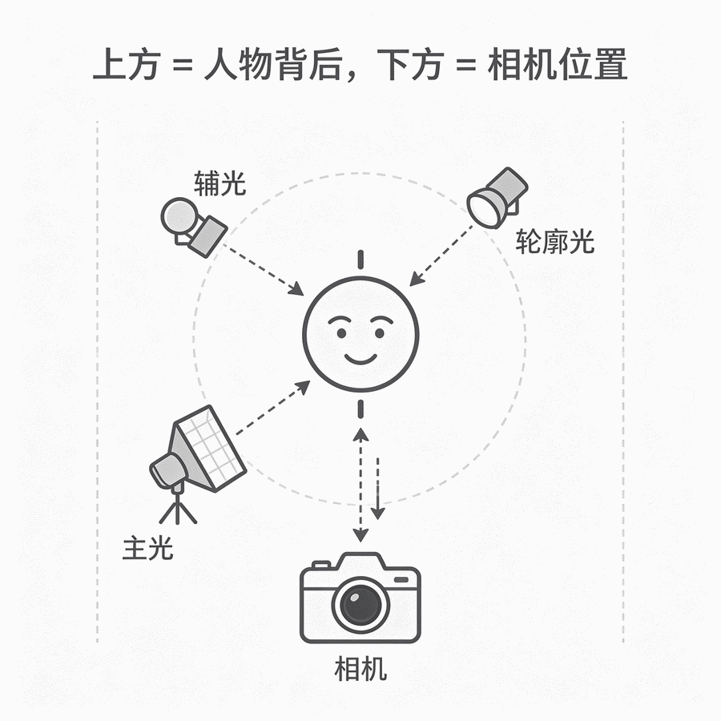
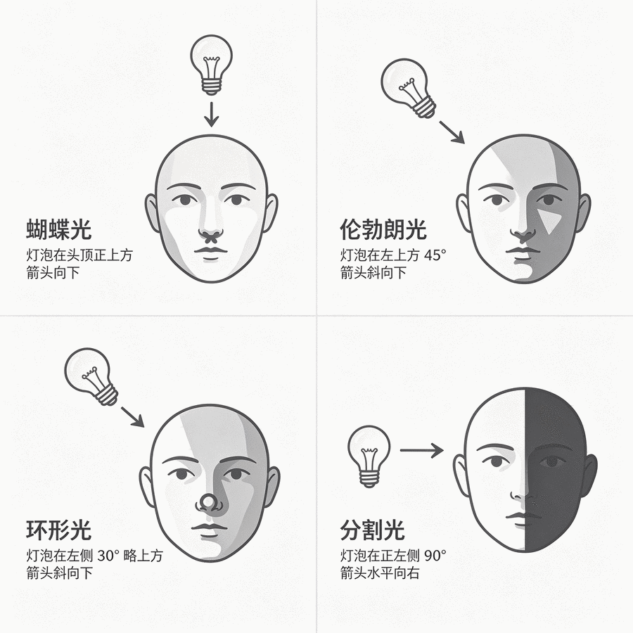

# 布光基础

## 先说问题

刚买闪光灯的人常遇到三个困惑：

1. 灯明明很亮，脸还是暗的；
2. 阴影硬得像刀切，皮肤瑕疵全出来；
3. 加了第二盏灯，画面反而更乱。

这三个问题分别对应布光的三个变量：**方向、质感、光比**。只有按这个顺序学，才不会"灯越多越乱"。

## 一、学习路径：从一盏灯开始

| 阶段 | 内容 | 目标 |
|---|---|---|
| 1. 机顶闪 | TTL/手动、直打/跳闪 | 先能把人拍亮 |
| 2. 单灯离机 | 45° 主光、硬光/软光、光比 | 会塑形 |
| 3. 双灯 | 主光 + 辅光 / 主光 + 轮廓光 | 会控制层次 |
| 4. 三点式 | 主光 + 辅光 + 轮廓光 | 完整体系 |
| 5. 扩展 | 背景光、发丝光、色片、图案片 | 氛围与风格 |

练习原则：**每一步拍够几十张再加灯。**单灯都控制不好，第二盏只会让画面更乱。

## 二、方向：光从哪里来，决定脸怎么"长"

| 光位 | 角度 | 效果 | 典型用途 |
|---|---|---|---|
| 正面光（蝴蝶光位） | 镜头正上方 0°–15° | 脸部均匀，鼻下小阴影，显年轻 | 美妆、证件照、时尚 |
| 45° 侧光（伦勃朗位） | 左右前方 45° | 一明一暗，暗侧脸颊出现小三角亮斑 | 经典人像、油画感 |
| 90° 侧光（分割光） | 正侧方 90° | 半边脸亮、半边全暗，对比极强 | 戏剧、男性硬照 |
| 逆光/轮廓光 | 背后 135°–180° | 边缘勾亮，与背景分离 | 氛围、分离、发丝光 |
| 顶光 | 头顶正上方 | 眼窝、鼻下、下巴阴影重 | 舞台、阴天正午 |
| 底光 | 下方往上 | 反自然，恐怖感 | 恐怖片、特殊效果 |

判断光位是否"好看"的标准不是角度数字，而是**阴影落在哪里**：鼻影会不会切断脸颊、眼窝有没有补到眼神光、下颌线有没有被勾出来。

## 三、质感：硬光与软光由"相对面积"决定

很多人以为"柔光箱 = 软光、裸灯 = 硬光"，其实决定软硬的是**光源相对于被摄体的角直径**：

- 光源面积大、距离近 → 相对面积大 → 阴影边缘柔和；
- 光源面积小、距离远 → 相对面积小 → 阴影边缘锐利。

所以同一支裸灯，贴近脸打比远处打要"软"；同一个柔光箱，拉到 5 米外也会变"硬"。**距离和尺寸比附件类型更关键。**

详见《软光与硬光的区别》。

## 四、光比：主光与环境光/辅光的亮度差

光比 = 主光亮度 : 辅光（或环境光）亮度。

| 光比 | 影调 | 情绪 | 典型 |
|---|---|---|---|
| 1:1–1:2 | 高调，阴影很浅 | 清新、柔和、商业 | 美妆、婚纱、日系 |
| 1:4 | 中间调，有立体感 | 自然、稳重 | 常规人像 |
| 1:8 以上 | 低调，暗部深 | 戏剧、神秘、力量 | 电影感、男性肖像 |

用闪光灯时，光比还受"闪光 vs 环境光"影响：

- 闪光强、环境弱 → 主体亮、背景暗，主体突出；
- 闪光与环境接近 → 氛围自然，但要小心色温打架（闪光 5600K vs 钨丝灯 3200K）。

## 五、三点式布光

### 1. 主光（Key Light）

- 位置：相机左前或右前 30°–45°，略高于眼睛 20–40cm；
- 作用：决定脸部主要明暗结构，是画面最亮的光；
- 亮度：基准，通常也是唯一"有方向感"的光。

### 2. 辅光（Fill Light）

- 位置：主光对侧，低一些（约眼平或略低）；
- 作用：把暗部阴影提亮，控制光比；
- 亮度：比主光弱 1–2 档（光比 1:2 到 1:4）；
- 形式：柔光箱、反光板、白墙反射都行。

### 3. 轮廓光（Rim / Back Light）

- 位置：人物侧后方 135°–160°，高于头顶；
- 作用：勾头发和肩膀边缘，把人从背景里"切"出来；
- 亮度：通常低于主光，避免抢脸。

### 为什么顺序不能反

先主光定结构 → 再辅光定光比 → 最后轮廓光定分离。先加轮廓光会让脸显得平，先加辅光会让阴影失去方向。

## 六、常见光型速查

| 光型 | 主光位置 | 特征 | 适合 |
|---|---|---|---|
| 蝴蝶光 | 镜头正上方，略前 | 鼻下蝴蝶形小阴影，颧骨下有阴影 | 女性、时尚、修饰圆脸 |
| 伦勃朗光 | 45° 侧上方 | 暗侧脸颊三角亮斑 | 经典肖像、有故事感 |
| 环形光 | 30°–40° 侧上方 | 鼻影呈小环形，不接嘴角 | 最自然，通用 |
| 分割光 | 90° 正侧 | 半边脸全暗 | 强对比、戏剧 |
| 高调光 | 多灯均匀 | 整体明亮，阴影极浅 | 商业、婚纱、清新 |
| 低调光 | 单灯侧逆 | 大面积暗，少量亮部 | 电影感、神秘 |

## 七、轮廓光不能亮过主光

如果轮廓光 > 主光，会发生三件事：

1. 头发肩膀像镶了光边，人物"发光"；
2. 脸相对变暗，观众视线被边缘亮点带走；
3. 画面从"人像"变成"舞台剪影"。

正常关系是 **主光 > 辅光 > 轮廓光**（轮廓光约比主光低 1–2 档）；想要氛围可以做到主光 ≈ 轮廓光；想要艺术感才让轮廓光压过主光。

## 八、一张练习清单

1. 单灯 45°，只改距离，观察阴影从硬到软；
2. 单灯换正面/侧面/逆光，各拍 10 张，比较脸部结构；
3. 加反光板，从近到远挪，体会光比 1:2 → 1:8；
4. 加第二盏做轮廓光，先调低亮度，再逐渐提高，找到"刚好分离"的点；
5. 三点式拍一组，再关掉辅光拍一组，对比"有层次"和"有结构"的差别。

## 要点回顾

- 方向塑形，质感定软硬，光比定情绪，顺序不能反。
- 软硬由光源相对面积决定，不是附件名字。
- 三点式：主光定结构 → 辅光控光比 → 轮廓光做分离。
- 轮廓光常规低于主光 1–2 档。

> 参考：Fil Hunter《Light, Science & Magic》；尼康/保富图布光教程。
