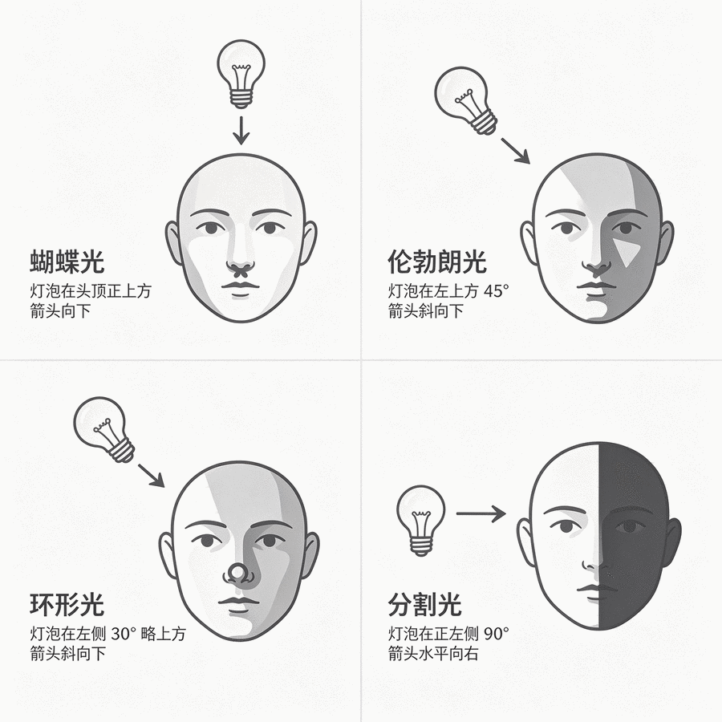

# 脸型与光位

## 先说问题

"圆脸用侧光、方脸用柔光"这类口诀人人会背，但一上手就发现：同一个 45° 侧光，有人拍完脸小了，有人拍完颧骨更突出。

原因在于口诀只给了"光位"，没给"阴影落在哪"。**光位之所以能修饰脸型，是因为它把阴影投在特定位置，而阴影在视觉上等于"后退、变窄、变凹"。**

## 一、先记住一条底层规则

> 想让哪里显瘦，就让哪里落阴影；想让哪里显平，就让哪里受光。

由此推出：

- 脸宽 → 用侧光，让一侧落阴影，视觉宽度收窄；
- 脸圆 → 用 45° 侧上方，让颧骨下方和下颌出现阴影，制造纵向线条；
- 脸长 → 用正面光/平光，减少纵向阴影，避免"更长"；
- 颧骨高 → 避免从下往上打（仰光会把颧骨下方照亮，反而强调突出），要用略高的侧光把颧骨下方的凹陷压暗，再用柔光过渡。

原来的笔记把"高颧骨 → 微仰拍"写成建议，这是反的：仰拍会放大颧骨和下颌，正确做法是**略俯 + 侧光**。

## 二、七种脸型的光位建议

| 脸型 | 特征 | 光位 | 机位 | 要避免 |
|---|---|---|---|---|
| 圆脸 | 脸宽≈脸长，下颌圆 | 45° 侧上方（伦勃朗/环形） | 略俯 10°–15° | 正面平光、仰拍 |
| 方脸 | 下颌角明显、脸宽 | 蝴蝶光或大柔光箱正面偏上 | 平视或略俯 | 90° 硬侧光（会强调下颌角） |
| 长脸 | 纵向长、额头或下巴偏长 | 正面平光/环形光，光位放低 | 略俯 | 顶光、纵向侧光 |
| 瓜子/鹅蛋 | 比例均衡 | 任意，优先环形光 | 平视 | 过度修饰反而假 |
| 心形脸 | 额头宽、下巴尖 | 环形光 + 柔光，额前压暗 | 略俯 | 高位顶光（额头更亮更宽） |
| 大饼脸（宽扁） | 脸宽、颧骨平、下颌宽 | 45° 侧光 + 三分之二侧脸 | 略俯 | 正面光、平视正脸 |
| 高颧骨 | 颧骨突出、面颊凹 | 略高侧光 + 柔光过渡 | 略俯 | 仰拍、底光、硬侧光 |

## 三、四种常用光位的修饰逻辑

### 1. 蝴蝶光（正上方 0°–15°）

- 鼻下形成蝴蝶形小阴影，颧骨下方两侧落影；
- 视觉上"收窄颧骨、拉长中庭"，适合圆脸、宽脸；
- 缺点是眼窝深的人会显得更凹，需要加反光板补眼神光。

### 2. 伦勃朗光（45° 侧上方）

- 暗侧脸颊出现三角亮斑，脸被"切"成明暗两半；
- 收窄效果最强，适合圆脸、方脸、想拍出故事感的人；
- 对鼻梁低的人不友好（三角斑可能不成立）。

### 3. 环形光（30°–40°）

- 鼻影呈小环形，不接到嘴角，最接近自然光；
- 通用性最好，几乎不挑脸型；
- 修饰力度中等，适合"不想太假"的日常人像。

### 4. 分割光（90° 正侧）

- 半边脸完全在暗部，对比最强；
- 适合轮廓清晰、五官立体的人；
- 圆脸用会"切"得太狠，方脸用会强调下颌角，慎用。

## 四、机位高度与脸型

| 机位 | 效果 | 适合 | 不适合 |
|---|---|---|---|
| 略俯（高 10–20cm） | 额头/颧骨受光，下颌收窄，显脸小 | 圆脸、方脸、大饼脸、高颧骨 | 长脸（会更长） |
| 平视 | 比例真实，五官不变形 | 鹅蛋脸、证件照、纪实 | 想藏双下巴时不够用 |
| 略仰（低 10–20cm） | 下颌线突出，气场强 | 男性、硬照、想显气场 | 圆脸、双下巴、高颧骨 |

注意"略俯"不是"高机位俯拍全身"。人像修饰通常只高 10–20cm、俯 5°–10°，幅度过大会让额头变大、下巴消失。

## 五、口诀（修正版）

- 圆脸 → 侧光收窄，略俯
- 方脸 → 柔光削角，避硬侧
- 长脸 → 平光压缩，光位放低
- 瓜子 → 百搭，环形最稳
- 心形 → 柔和减尖，压暗额头
- 大饼 → 侧脸修饰，三分之二侧
- 高颧骨 → 高位侧光 + 柔化，别仰拍

## 六、一个实战检查法

拍三张不同光位，只看三个位置：

1. **鼻影**：有没有切断脸颊？切断了显得脸窄，但可能假；
2. **颧骨下方**：有没有阴影？有则显凹、显瘦；
3. **下颌线**：有没有被勾出来？勾出来显利落。

三个位置都满意，光位就对了；只看"脸大不大"容易忽略结构。

## 要点回顾

- 光位修饰的本质是"阴影落在哪"。
- 圆脸靠侧光收窄，长脸靠平光压缩，高颧骨靠高位侧光而非仰拍。
- 机位只需略俯 10–20cm，幅度过大会变形。
- 检查鼻影、颧骨下阴影、下颌线三处，比看整体更准。

> 参考：Fil Hunter《Light, Science & Magic》；《人像摄影用光》面部结构章节。
