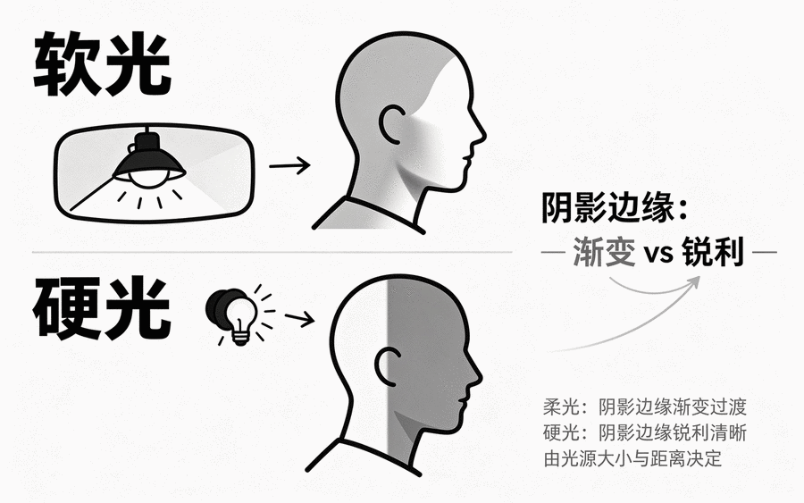

# 软光与硬光的区别

## 先说问题

"柔光箱出软光、裸灯出硬光"——这句话只对了一半。把柔光箱拉到 5 米外，阴影照样硬；把裸灯贴到脸前 30cm，阴影也会变软。

真正决定软硬的不是附件，而是**光源在被摄体看来"有多大"**。理解这一点，才能在没有柔光箱的时候也做出软光。

## 一、核心原理：相对面积（角直径）

阴影的软硬，取决于**半影区**的宽度。半影来自"光源上每个点都在投影，但位置略有偏移"，偏移量越大，边缘越模糊。

决定半影宽度的是光源的角直径：

$$
\theta \approx \frac{D}{d}
$$

$D$ 是光源有效尺寸，$d$ 是光源到被摄体距离。

- θ 大（光源大且近）→ 半影宽 → 软光；
- θ 小（光源小或远）→ 半影窄 → 硬光。

所以：

- 同一支裸灯，贴近脸 → 相对面积大 → 偏软；
- 同一个 90cm 柔光箱，退到 5 米 → 相对面积小 → 偏硬；
- 太阳很大，但离地球 1.5 亿公里 → 角直径只有 0.5° → 硬光；
- 阴天整个天空都是光源 → 角直径接近 180° → 极软。

**一句话：软硬看"光源张角"，不看瓦数，也不看附件名字。**

## 二、两种光的画面特征

| 维度 | 软光 | 硬光 |
|---|---|---|
| 阴影边缘 | 渐变、模糊 | 锐利、清晰 |
| 明暗过渡 | 平缓 | 突变 |
| 高光 | 面积大、过渡柔 | 小而亮、易过曝 |
| 皮肤 | 细腻、瑕疵被柔化 | 毛孔、痘印被放大 |
| 立体感 | 弱（过渡多） | 强（明暗对比直接） |
| 情绪 | 温柔、梦幻、商业 | 硬朗、戏剧、纪实 |

注意"立体感"这一项常被误解：软光不是没有立体感，而是立体感来自**明暗渐变**；硬光的立体感来自**明暗突变**。两者都能塑造体积，只是语言不同。

## 三、附件只是"改变光源面积"的工具

### 变软（增大有效发光面积）

- 柔光箱（八角、方形、长条）：面积越大越软；
- 柔光伞（透光伞）：把点光源变成面光源；
- 蝴蝶布/柔光屏：大面积扩散；
- 白墙、天花板跳闪：用反射面当光源；
- 反光板：把光"二次扩散"到暗部。

### 变硬（缩小有效发光面积或增加方向性）

- 裸灯/标准罩：保留灯管的小面积；
- 聚光筒/束光筒（猪嘴）：把光收成窄束；
- 蜂巢/网格：限制光束角度；
- 雷达罩（ beauty dish）：介于软硬之间，中心硬、边缘柔；
- 银色反光伞：反射面小且集中，比透光伞硬。

**原来的笔记把"反光伞"整体归为硬光附件，这不准确**：银色反光伞偏硬，白色透光伞偏软，要按类型分。

## 四、距离的杠杆作用

软光箱从 1 米挪到 3 米，角直径降到 1/3，阴影立刻变硬；同时照度按平方反比降到 1/9。所以"拉远柔光箱"同时带来两个变化：变硬 + 变暗。

实战含义：

- 想要大柔光又不想太暗 → 用更大的箱子，而不是拉远；
- 想要硬光又不想太亮 → 用蜂巢收束，而不是贴近；
- 空间不够放 120cm 箱子 → 用跳闪打天花板，等效一个巨大的面光源。

## 五、按题材选光质

| 题材 | 建议 | 理由 |
|---|---|---|
| 女性、美妆、婚纱 | 软光为主 | 皮肤细腻，阴影浅 |
| 男性硬照、纪实 | 硬光或半硬 | 结构感、质感 |
| 产品（金属、玻璃） | 大面积柔光 + 黑卡控制 | 控制反射形状 |
| 产品（粗糙材质） | 侧硬光 | 强化纹理 |
| 电影感低调人像 | 硬主光 + 柔辅光 | 强对比但有细节 |
| 日系、工笔画风 | 极软光 + 低对比 | 通透、平面化 |

## 六、一个常被忽略的点：光的"方向性"

软光因为来自多个方向，会产生"包裹感"，阴影往被摄体背后走；硬光方向单一，阴影直接投在脸上。

所以拍圆脸想显瘦，不是一味加柔，而是**用侧向的软光**：既有渐变的柔和，又有侧光收窄脸型的作用。纯正面软光只会让脸更平。

## 要点回顾

- 软硬由光源角直径 θ≈D/d 决定，与瓦数无关。
- 附件的作用是改变有效发光面积。
- 拉远柔光箱 = 变硬 + 变暗，两个效果同时发生。
- 圆脸显瘦要"侧向软光"，不是"正面大柔光"。

> 参考：Fil Hunter《Light, Science & Magic》第 3 章"表面与边缘"。
