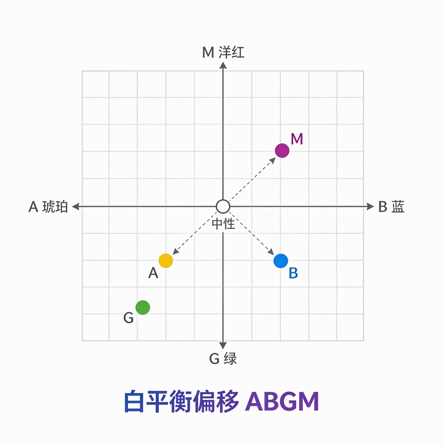

# 白平衡偏移

## 先说问题

自动白平衡在混合光下经常"翻车"：窗光偏蓝、路灯偏黄、脸一会儿青一会儿红。手动设了 K 值，又发现要么整体偏、要么肤色脏。

白平衡其实有两层控制：

- **色温（K 值）**：管整体冷暖；
- **偏移（A-B / G-M 网格）**：管"在冷暖之外，往哪个颜色偏"。

原笔记把 K 值方向写反了，也把偏移的坐标讲得比较乱，这一篇重新整理。

## 一、色温 K 值：方向别记反

相机里的 K 值，是你**告诉相机"现在的光有多暖"**：

- 设定值**高于**真实光源 → 相机认为光偏暖，加蓝补偿 → **画面偏冷（蓝）**；
- 设定值**低于**真实光源 → 相机认为光偏冷，加黄补偿 → **画面偏暖（黄）**。

记一句：**相机 K 值调高 = 画面变蓝；调低 = 画面变黄。**

这和"光的色温越高越蓝"是同一套物理，但一个是描述光，一个是描述相机的补偿，所以容易绕。

常见光源参考（不是死数，以现场为准）：

| 光源 | 色温（K） | 相机设定后感觉 |
|---|---|---|
| 蜡烛 | 1800–2000 | 很暖、偏红 |
| 钨丝灯 | 2800–3200 | 暖黄 |
| 荧光灯 | 4000–5000 | 偏冷或偏绿 |
| 正午日光 | 5200–5500 | 中性 |
| 阴天 | 6000–6500 | 稍冷 |
| 阴影 | 7000–8000 | 更冷 |
| 蓝天/黄昏 | 9000–10000 | 很冷 |

相机色温范围一般 2500–10000K（尼康 Z5 等），步进 10K 或 50K。V480 闪光灯约 5600K，和日光接近。

## 二、偏移网格：ABGM 四个方向

相机偏移界面是一个二维网格：

- **横轴**：A（Amber，琥珀）↔ B（Blue，蓝）；
- **纵轴**：G（Green，绿）↔ M（Magenta，洋红）；
- 中心是"不偏移"，每格约 1–2 Mired。

| 方向 | 画面变化 | 用途 |
|---|---|---|
| B | 偏冷、偏蓝 | 去黄、日系、雪景 |
| A | 偏暖、偏黄橙 | 复古、夕阳、港风 |
| G | 偏绿 | 修正荧光灯偏洋红，或做"胶片绿" |
| M | 偏洋红/红紫 | 修正绿色偏色，或做"昭和" |

关键理解：**K 值和偏移是两个通道。**K 值把整幅画往蓝或黄推，偏移是在这个基础上"再往某个方向染色"。只调 K 值，画面可能"冷但发绿"；只调偏移，可能"色偏对了但整体还是黄"。

## 三、Mired：为什么低色温区更敏感

色温的倒数乘以 10⁶ 叫微倒度（Mired）：

$$
\text{Mired} = \frac{10^6}{K}
$$

- 3200K → 312 Mired；3400K → 294 Mired，差 18；
- 8000K → 125 Mired；8200K → 122 Mired，差 3。

同样的 200K 变化，在低色温区（钨丝灯）造成的视觉偏移，比高色温区（阴天）大得多。所以：

- 室内钨丝灯下微调 K 值，效果很明显；
- 阴天/雪地微调 200K，几乎看不出。

偏移网格按 Mired 等距设计，也是这个原因。

## 四、AWB 的工作流程

1. **实时取景**：相机持续采样 RGB，重点参考对焦点区域，估算色温；
2. **半按快门**：锁定当前估算值；
3. **完全按下**：把结果写入 JPEG 元数据；
4. **写入存储卡**：JPEG 存最终像素；RAW 只记录"当时的白平衡设定"，像素数据不变，后期可改。

所以**拍 RAW 时白平衡是"可逆"的**，拍 JPEG 则是"定死"的。混合光场景建议 RAW。

## 五、偏移的两种用法

### 1. 校正偏色

- 荧光灯下画面发绿 → 往 M 偏 1–2 格；
- 阴影里画面发蓝 → 往 A 偏 1–2 格；
- 夕阳下画面过黄 → 往 B 偏 1 格，但通常保留暖调更好看。

### 2. 渲染氛围

| 组合 | 风格 | 说明 |
|---|---|---|
| A+G | 港风/胶片 | 偏黄绿，王家卫式怀旧；K 值可略提，别偏洋红 |
| B+G | 日系清新 | 冷调带青绿，画面通透 |
| B+M | 昭和/海边情绪 | 蓝紫、浓郁，适合夜景、海边 |
| A+M | 复古情绪 | 黄红、浓烈，K 值略提 |

每格偏移已经很可见，**一次别超过 3 格**，否则白平衡彻底失准，肤色先崩。

## 六、YCrCb 坐标：偏移到底在哪个平面

YCbCr 里：

- $Y$ 是亮度；
- $Cb$ 是"蓝差"（Blue − Y），正方向偏蓝，负方向偏黄；
- $Cr$ 是"红差"（Red − Y），正方向偏红，负方向偏青。

对应到 ABGM 网格：

| 方向 | YCbCr 位置 |
|---|---|
| 蓝（B） | Cb 正向 |
| 琥珀/黄（A） | Cb 负向 |
| 洋红（M） | Cr 正向 + Cb 正向（右上） |
| 绿（G） | Cr 负向 + Cb 负向（左下） |

原笔记把"绿色 = Cr 大负向（向左）"写成单向，实际绿色是**左下方向**（Cr 和 Cb 都为负），这样二维图才闭合。

## 七、实战建议

1. **先求准，再求风格**：先用灰卡或白纸自定义白平衡，再加偏移；
2. **混合光先统一光源**：能关掉荧光灯就关，能加色纸就加，别让相机同时修两种色温；
3. **拍 RAW 保留余地**：现场偏移只作监看，最终在后期定；
4. **人像偏移宁少勿多**：肤色对绿/洋红极敏感，1 格就够。

## 要点回顾

- K 值调高偏蓝、调低偏黄，方向和"光的色温"相反。
- 偏移是 ABGM 二维网格，K 值是冷暖单轴，两者叠加。
- Mired 解释了为什么低色温区更敏感。
- RAW 白平衡可逆，JPEG 定死。

> 参考：尼康 Z 系列白平衡章节；CIE 色温与 Mired 定义；ITU-R BT.601 YCbCr。
