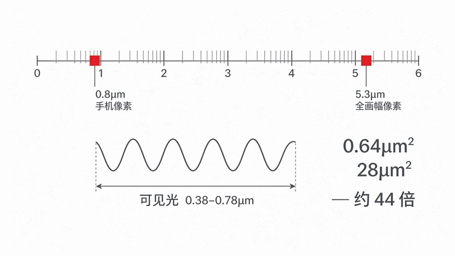

# CMOS 像素大小的物理限制

## 先说问题

手机厂宣传"一亿像素"，听起来比全画幅的 4500 万还高，但画质并没有碾压。为什么？因为**像素不是越小越好，它受两条物理红线限制：光的波长和镜头的光学极限。**

原来的笔记里有两处需要更正：

- "一英寸传感器 13.3×10.0mm"——1 英寸传感器的 4:3 有效面约 **13.2×8.8mm**，不是 10mm 高；
- 举例的三星 HM2 / HM3 **不是 1 英寸**：HM2 是 1/1.52″（0.7µm），HM3 是 1/1.33″（0.8µm）。1 英寸的亿级像素机型并不存在主流产品。

改正之后重新算一遍，反而更能说明问题。

## 一、先算一个真实的例子：1/1.33″ 一亿像素

三星 HM3：1.08 亿像素，传感器 1/1.33″，4:3 有效面约 9.6×7.2mm。

设长边 4a 像素、短边 3a 像素：

$$
4a \cdot 3a = 12a^2 = 108{,}000{,}000
$$

$$
a^2 = 9{,}000{,}000 \Rightarrow a = 3000
$$

长边 12000 像素、短边 9000 像素。

$$
\text{像素尺寸} = \frac{9.6\text{mm}}{12000} = 0.8\,\mu m
$$

宽高两个方向都是 0.8µm，正好对上 HM3 官方标称的 0.8µm。**这才是这枚传感器的真实数字。**

如果硬按"1 英寸 + 1.08 亿"算（13.2×8.8mm），像素约 1.1µm × 0.98µm，也不是正方形。所以"底越大像素越大"这句话要加前提：**同样像素数下才成立。**

## 二、红线一：可见光波长

可见光波长 0.38–0.78µm，常取绿光 0.55µm 作代表。

0.8µm 的像素，宽度上只能容纳约 1.5 个绿光波长。这意味着：

- 单个像素已经接近"无法用几何光学描述"的尺度；
- 像素间的串扰（crosstalk）、量子效率下降会明显加剧；
- 微透镜、深槽隔离（DTI）工艺成了必需品，不是加分项。

## 三、红线二：衍射极限

光通过光圈会衍射，形成一个艾里斑（Airy disk），直径：

$$
d = 2.44 \lambda N
$$

其中 λ 是波长，N 是光圈 f 值。

| 光圈 | 绿光艾里斑直径 | 对 0.8µm 像素的意义 |
|---|---|---|
| f/1.8 | 2.4µm | 已覆盖 3 个像素 |
| f/2.8 | 3.8µm | 覆盖近 5 个像素 |
| f/8 | 10.7µm | 覆盖 13 个像素 |
| f/16 | 21.5µm | 覆盖 27 个像素 |

结论很直接：**像素小于艾里斑时，收小光圈不会增加解析力，只会让画面变软。**这就是手机主摄"光圈不能太小"、高像素模式"只能在最大光圈用"的原因。

对全画幅 4500 万（像素约 5.3µm）来说，f/11 的艾里斑约 14.7µm 才明显影响，所以全画幅可以放心收到 f/11–f/16。

## 四、红线三：信噪比与阱容

像素是一个"接光子的桶"：

- 面积 0.8×0.8 = 0.64µm²，只有全画幅 5.3µm 像素（28µm²）的 **1/44**；
- 同样照度下，接收光子数少 44 倍，散粒噪声的相对比例高 √44 ≈ 6.6 倍；
- 阱容（满阱电子数）也小，强光下更容易饱和，动态范围受限。

三个后果：暗光噪点多、高光容易过曝、动态范围窄。这不是算法能完全弥补的，是面积决定的。

## 五、厂商的解法：像素合并

把相邻 2×2 像素合并成 1 个大像素：

- HM3：0.8µm → 1.6µm，1.08 亿 → 2700 万；
- HM2：0.7µm → 1.4µm，1.08 亿 → 2700 万；
- IMX989（1 英寸，5000 万，1.6µm）：四合一后 3.2µm、1250 万。

合并的收益：

- 感光面积 ×4，信噪比约 ×2（√4）；
- 读出数据量降到 1/4，处理更快、发热更低；
- 暗光画质显著改善。

代价是分辨率下降。所以手机默认用合并模式，强光下才切"高像素模式"，且高像素模式通常禁用 HDR 多帧、限制变焦。

## 六、全画幅、APS-C、M4/3 的像素尺寸对照

| 画幅 | 面积（约） | 2400 万像素时 | 4500 万像素时 | 6100 万像素时 |
|---|---|---|---|---|
| 全画幅 36×24 | 864mm² | 6.0µm | 4.4µm | 3.8µm |
| APS-C 23.5×15.6 | 366mm² | 3.9µm | 2.9µm | 2.4µm |
| M4/3 17.3×13 | 225mm² | 3.3µm | 2.4µm | 2.0µm |
| 1 英寸 13.2×8.8 | 116mm² | 2.2µm | 1.6µm | 1.4µm |
| 1/1.33″ 9.6×7.2 | 69mm² | 1.7µm | 1.3µm | 1.1µm |

规律：**同样的像素数，画幅越小像素越小，衍射和噪声的红线来得越早。**这就是"小底高像素"在物理上吃亏的根本原因。

## 七、尺度可比性：什么时候用几何光学、什么时候必须用波动光学

判断标准是"孔径尺寸 a 与波长 λ 的比值"：

| 关系 | 现象 | 适用理论 |
|---|---|---|
| a ≫ λ（如窗户、镜头口径） | 光直线传播，阴影边界清晰 | 几何光学 |
| a ≈ λ（如 0.8µm 像素、小孔） | 明显衍射，光绕进阴影区 | 波动光学 |
| a ≪ λ | 传播严重受限，需电磁理论 | 近场光学 |

摄影里的分界线大致在 1–2µm：**像素、微透镜、小光圈都在波动光学区间，不能用"光线直线走"的直觉去推断。**

## 要点回顾

- 1 英寸 4:3 有效面约 13.2×8.8mm；HM3 是 1/1.33″、0.8µm，不是 1 英寸。
- 像素尺寸受可见光波长与衍射极限双重限制，0.8µm 已在红线附近。
- 艾里斑 d=2.44λN，f/2.8 已达 3.8µm，超过多数手机像素。
- 像素合并用分辨率换信噪比，是工程上的折中，不是"黑科技"。

> 参考：瑞利判据；EMVA 1288；三星 ISOCELL HM3 / HM2 产品资料；索尼 IMX989 公开参数。
