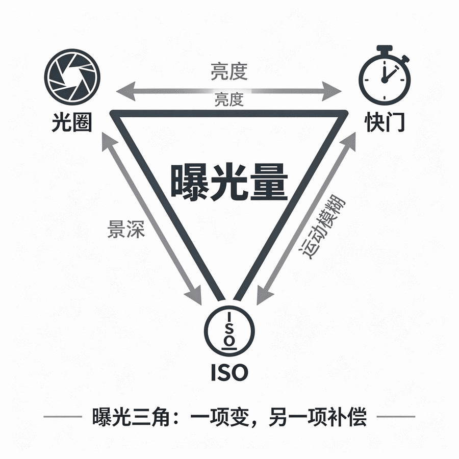

# 一档亮度与 EV（曝光值）

## 先说问题

新手最容易卡在三个地方：

1. 听说"加一档"，但不知道到底动了什么，有时画面明显变亮，有时几乎没变化；
2. 相机上显示 `EV ±3`，菜单里又有"EV 值"，同一个词好像指两种东西；
3. 想按"阳光十六法则"估算曝光，却不知道那个 EV 是怎么来的。

这三件事的根都在同一个概念上：**EV 是曝光的坐标，不是亮度本身；一档是曝光量的倍数，不是画面亮度的倍数。**

## 一、一档到底是什么

"一档"（one stop）是曝光量的计量单位：**每加一档，感光元件接收的光量翻倍；减一档，减半。**

能改变曝光量的只有三个入口：

| 参数 | 加一档的做法 | 物理含义 |
|---|---|---|
| 光圈 | f 值除以 √2（f/4 → f/2.8） | 通光孔径面积翻倍 |
| 快门 | 时间乘以 2（1/250 → 1/125） | 进光时间翻倍 |
| ISO | 数值乘以 2（ISO 200 → 400） | 对同样光量的放大倍数翻倍 |

三者互相补偿：光圈开大一档、快门快一档，曝光量不变，但景深和运动模糊变了。这就是"曝光三角"的真正用途——**不是三个都要调，而是用它们交换不同的画面效果。**

常见档位序列（每格相差一档）：

- 光圈：f/1、1.4、2、2.8、4、5.6、8、11、16、22（公比为 √2，所以叫"√2 序列"）
- 快门：1/1000、1/500、1/250、1/125、1/60、1/30、1/15、1/8…
- ISO：100、200、400、800、1600、3200、6400…

现代相机默认按 1/3 档步进（如 f/3.5、1/320、ISO 125），所以你会看到"加 0.3 档""加 0.7 档"这种说法。

## 二、EV 的严格定义

EV（Exposure Value，曝光值）是把"光圈 + 快门"这一组组合折算成的一个数：

$$
EV = \log_2 \frac{N^2}{t}
$$

其中 $N$ 是光圈 f 值，$t$ 是快门时间（秒）。

举例：f/1.0 + 1 秒 → EV = log₂(1/1) = 0；f/16 + 1/125 秒 → EV = log₂(256 × 125) ≈ 15。

**同一 EV 下，所有"光圈 × 快门"的组合曝光量相同**，比如 f/2.8 + 1/500 与 f/8 + 1/60 都是 EV≈13。EV 原本的设计目的，就是给不同镜头、不同快门做一张统一的曝光换算表。

注意：这个定义里**没有 ISO**。所以严格说 EV 描述的是"进了多少光"，不是"画面多亮"。ISO 决定同样的 EV 下画面亮多少。

## 三、EV 与场景亮度（EV100 / LV）

摄影里常说的"这个场景 EV 多少"，其实是把 ISO 固定为 100 后的**场景亮度值 LV（Light Value）**，记作 EV100。此时"场景亮度"和"正确曝光的 EV"数值相等，两个概念才被混着叫。

常用参考（ISO 100）：

| 场景 | 约 EV100 | 典型设置 |
|---|---|---|
| 阳光直射的雪地/沙滩 | 16 | f/16、1/500 |
| 晴天阳光（阳光十六法则） | 15 | f/16、1/125 |
| 晴天阴影 / 薄云 | 12–13 | f/8、1/250 |
| 阴天 | 11–12 | f/5.6、1/250 |
| 日出日落 | 10–12 | f/8、1/125 |
| 室内明亮窗光 | 7–9 | f/2.8、1/60 |
| 家居夜晚灯光 | 4–6 | f/1.8、1/30 |
| 夜景街道 | 2–4 | f/1.8、1/15、ISO 3200 |
| 烛光、月光 | −2–0 | 长曝光或高 ISO |

"阳光十六法则"就是这张表的一行：晴天把光圈设 f/16，快门取 ISO 的倒数（ISO 100 → 1/100 秒），基本能得到正常曝光。

## 四、三个常见误区

**误区一：一档 = 画面亮度翻倍。**
曝光量翻倍，输出的像素值约翻倍，但人眼对亮度的感知接近对数关系。所以"加一档"看起来只是"亮了一些"，不是"亮一倍"。这也是为什么后期提亮一档和前期多曝一档，观感并不完全等价。

**误区二：EV 就是亮度。**
亮度是物理量（单位 cd/m² 或 lx），EV 是光圈快门的组合坐标。同一个场景亮度下，你可以用不同的 EV 组合拍出同样的曝光（例如小光圈长曝光）。

**误区三：ISO 也是"档"，所以它属于 EV。**
ISO 不属于 EV 公式。提高 ISO 不会让镜头进更多光，只是把已有信号放大，同时放大噪点。把 ISO 当成"曝光三角的第三边"是方便记忆的说法，物理上它属于"增益"，不属于"曝光"。

## 五、和后期曝光补偿的关系

相机上的 `±EV` 补偿，本质是让测光结果偏移若干档：+1 EV 就是"按测光值再多曝一档"。它只影响自动曝光（P/A/S 档）或提示，不改变 M 档下你手动设定的值。

所以看到直方图右侧溢出，减 0.7 EV；看到主体发闷、暗部贴左墙，加 0.7 EV——这里的"EV"是档数，不是亮度数值。

## 要点回顾

- 一档 = 曝光量 ×2 或 ÷2，通过光圈、快门、ISO 任一入口实现。
- EV = log₂(N²/t)，是光圈快门的组合坐标，不含 ISO。
- EV100（LV）才用来表示场景亮度。
- 加一档是曝光量翻倍，不是视觉亮度翻倍。

> 参考：ISO 2720 曝光值定义；阳光十六法则（Sunny 16 Rule）。
