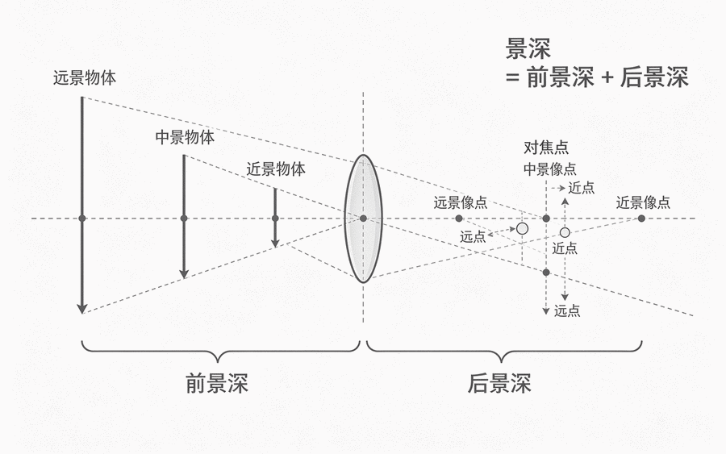

# 景深计算

## 先说问题

"光圈越小景深越深"这句话人人会背，但一算就乱：

- 为什么 50mm f/1.8 在 1 米处景深只有几厘米，在 10 米处却有十几米？
- 为什么手机传感器那么小，拍什么都清楚？
- 为什么微距镜头 f/16 还是容易虚？

原来的笔记里公式量纲不对（写成了 $\Delta L_1 = F\delta L/(f+F\delta L)$，少了一次 $L^2/f^2$），算出来的数不能直接用。这一篇把公式重新推一遍，并给出可以直接代数的形式。

## 一、先明确景深是什么

景深不是"看起来清楚的范围"这么模糊——它有严格定义：**在像平面上，物点成像的弥散圆直径不超过容许值 δ 时，对应的物方距离范围。**

- 弥散圆（Circle of Confusion, CoC）δ：人眼在标准观看条件下分辨不出的最大模糊圆。全画幅常用 δ = 0.03mm，APS-C 约 0.019mm，M4/3 约 0.015mm。
- 景深 = 前景深 ΔL1 + 后景深 ΔL2，以对焦点为界。
- **后景深总是大于前景深**（约 1:2），所以拍人像对焦眼睛时，耳朵通常还在景深内，鼻子可能已经出景深。

## 二、公式（可直接代数）

设：

- $f$：焦距（mm）
- $N$：光圈 f 值（如 f/2.8 时 N=2.8）
- $L$：对焦距离（m，需与 δ 统一单位）
- $\delta$：容许弥散圆（mm）

前景深：

$$
\Delta L_1 = \frac{N \delta L^2}{f^2 + N \delta L}
$$

后景深：

$$
\Delta L_2 = \frac{N \delta L^2}{f^2 - N \delta L}
$$

总景深：

$$
DOF = \Delta L_1 + \Delta L_2 = \frac{2 f^2 N \delta L^2}{f^4 - N^2 \delta^2 L^2}
$$

近点 $L_{near} = L - \Delta L_1$，远点 $L_{far} = L + \Delta L_2$。

### 代入验算

50mm、f/1.8、对焦 1m、全画幅 δ=0.03mm（注意单位统一为 mm：L=1000mm）：

- 分母：f² = 2500，NδL = 1.8×0.03×1000 = 54
- ΔL1 = 54×1000² / (2500+54) ≈ 21,150 mm ≈ 21mm
- ΔL2 = 54×1000² / (2500−54) ≈ 22,100 mm ≈ 22mm
- 总景深 ≈ 43mm

和实拍体验一致：1 米处 f/1.8 的 50mm，景深只有 4 厘米左右，对焦稍偏就糊眼。

同一支镜头对焦 5 米：

- NδL = 1.8×0.03×5000 = 270
- ΔL1 = 270×25,000,000/(2500+270) ≈ 2,437,000 mm ≈ 2.4m
- 总景深约 5m

**距离从 1m 到 5m（×5），景深从 4cm 到 5m（×125）**——景深近似与距离平方成正比，这就是"退两步全清楚了"的数学解释。

## 三、四个影响因素，按强弱排序

| 因素 | 影响 | 定量关系 |
|---|---|---|
| 对焦距离 L | 最强 | 近似 ∝ L² |
| 光圈 N | 强 | 近似 ∝ N（线性） |
| 焦距 f | 强 | 近似 ∝ 1/f² |
| 容许弥散圆 δ（画幅） | 中 | 画幅越小 δ 越小，但短焦距补偿后反而景更深 |

所以：

- **想虚化**：靠近 + 长焦 + 大光圈，三件事一起做效果最猛；
- **想全清**：后退 + 广角 + 小光圈，必要时景深合成；
- **微距为什么难**：对焦距离只有十几厘米，L² 项极小，f/16 也只能覆盖几毫米。

## 四、超焦距：风光摄影的实用工具

当对焦距离拉到"超焦距 H"时，后景深刚好到无穷远：

$$
H = \frac{f^2}{N \delta} + f
$$

对焦在 H 上，景深范围是 $H/2$ 到无穷远。

例：24mm、f/8、δ=0.03mm → H = 576/0.24 + 24 = 2424mm ≈ 2.4m。

**风光常用做法**：广角 f/8–f/11，对焦在 2–3 米（超焦距附近），前景到远山都清楚。比对焦到无穷远更划算，因为对焦无穷远会浪费一半后景深。

## 五、景深的三条常见误读

1. **"小底景深大"不完全对**。小底 δ 小，但焦距也短，两者部分抵消；真正决定观感的是"等效光圈"和拍摄距离。手机拍人像虚化弱，主要是焦距短、距离近，不是传感器原罪。
2. **"景深内绝对清晰"错**。景深只保证弥散圆小于 δ，边界处已经"刚好能接受"，放大看仍然软。真正锐的只有焦平面。
3. **"景深预览按钮没用"错**。它按实际光圈收小取景，能真实看到景深，只是画面变暗。微距和风光拍摄时值得用。

## 要点回顾

- 景深由容许弥散圆 δ 定义，不是主观感受。
- 前景深 < 后景深，约 1:2。
- 景深近似与对焦距离平方成正比、与光圈值成正比、与焦距平方成反比。
- 超焦距 H = f²/(Nδ)，对焦 H 可得 H/2 到无穷远。

> 参考：ISO 18844（弥散圆与景深测量）；Adams《The Camera》景深章节。
