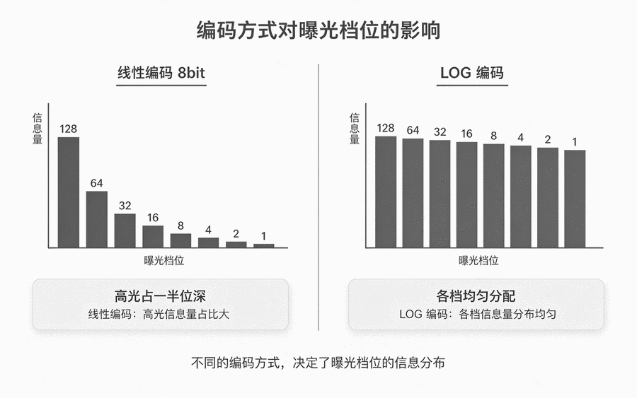

# 相机 Log 格式视频

## 先说问题

第一次拍 Log 的人都会问：**为什么拍出来是灰的？是不是坏了？**

不是坏了。Log 是相机故意把画面"压灰"，用亮度曲线的重新分配，把高光和暗部都塞进有限位深里，给后期留出调色空间。代价是前期必须正确曝光、正确白平衡，而且位深不够时会翻车。

这篇按"为什么要 Log → 怎么编码 → 怎么复原 → 哪里会踩坑"的顺序讲清楚。

## 一、线性编码的位深分配问题

假设相机用 8bit 记录，一共 256 个亮度级。传感器输出的亮度是线性的：每多一档曝光，光量翻倍。

于是亮度值分布是：

| 曝光区间 | 占用的亮度级 | 占位深比例 |
|---|---|---|
| 最亮一档（第 8 档） | 128 级 | 50% |
| 第 7 档 | 64 级 | 25% |
| 第 6 档 | 32 级 | 12.5% |
| 第 5 档 | 16 级 | 6.25% |
| 前 4 档合计 | 16 级 | 6.25% |

**一半的位深用来记录最亮那一档，暗部四档只分到 1/16。** 这就是"数码相机暗部容易断层、彩噪多"的编码层原因：不是传感器没信号，是编码没给它足够的格子。

## 二、Log 做了什么

把线性亮度值先过一个对数曲线，再量化：

$$
Y = K \cdot \log(1 + L)
$$

这是简化模型。实际各家曲线不同：

| 格式 | 厂商 | 特点 | 基准 ISO |
|---|---|---|---|
| N-Log | 尼康 | 10bit 4:2:2，约 12 档动态范围 | 800 |
| S-Log3 | 索尼 | 宽容度高，暗部抬得狠 | 800 / 640 |
| C-Log3 | 佳能 | 高光过渡自然 | 800 |
| V-Log | 松下 | 中性，调色空间大 | 800 |
| Log-C | ARRI | 行业基准，最接近胶片 | 800 |

对数曲线的作用：**把"每档曝光"映射成"大致等长的输出区间"**，暗部多分格子、高光少分格子，整体位深利用率变均匀。8bit 下暗部仍然不够，所以 Log 基本要求 10bit 起。

## 三、从光到屏幕的完整链路

1. **采样**：镜头成像 → 传感器光电转换 → ADC 量化成线性数字值；
2. **Log 编码**：套曲线压缩高光、抬升暗部，输出 10bit（部分机型 12bit RAW）；
3. **色彩处理**：白平衡、色域转换（传感器原生色域 → Rec.2020 / DCI-P3）；
4. **压缩**：H.265（HEVC）10bit 4:2:2 或 4:2:0，写入 MP4/MOV；
5. **回放**：播放器按 Rec.709 解码 → 看到灰片；
6. **后期**：套转换 LUT（N-Log → Rec.709）→ 再调色 → 输出。

注意第 3 步：**Log 只改亮度曲线，不改色域。**所以"Log 画面灰"是亮度映射问题，"色彩不对"是白平衡或色域问题，两者要分开排查。

## 四、LUT 在链路里的位置

LUT 是查找表，把 Log 值映射到显示空间。它做的是"压缩和映射"，**不能恢复已经丢掉的信息**。

- 转换 LUT（Technical LUT）：N-Log → Rec.709，负责把灰片变正常；
- 风格 LUT（Creative LUT）：在转换之后叠加胶片感、青橙调；
- 监看 LUT：只作用于监视器/取景器，不写进文件。

正确顺序是：**先转换 LUT 回到正常对比 → 再做曝光/白平衡校正 → 最后上风格 LUT。** 直接套风格 LUT 会连曝光判断都失真。

## 五、拍 Log 的五个坑

1. **8bit 拍 Log**：暗部只有几十级，一拉就断层、出现色带。要拍 Log 就开 10bit。
2. **按 Rec.709 的标准曝光**：Log 通常要"向右曝光"半档到一档（ETTR），把暗部推离噪声底，但别过曝高光。
3. **基准 ISO 用错**：N-Log 基准 ISO 800，用 ISO 100 拍会欠曝 3 档，暗部全毁。
4. **白平衡后期硬改**：Log 的色度信息被压缩，大幅改白平衡会偏色。前期用灰卡或固定色温。
5. **把 LUT 当调色**：LUT 是起点不是终点，套完还要做曲线、色轮、局部调整。

## 六、什么时候不该拍 Log

- 光线充足、直出交付的日常记录：拍标准/中性模式，省掉后期；
- 8bit 机身 + 手机剪辑：Log 的收益抵不过断层的损失；
- 需要高感拍摄：Log 基准 ISO 高，暗光下噪点更明显。

Log 是"给后期留余量"的工具，不是"画质更好"的保证。**余量用得上才值得拍。**

## 要点回顾

- 线性编码把一半位深给了最亮一档，暗部不够用；
- Log 用对数曲线重新分配位深，让各档曝光占位更均匀；
- Log 只改亮度曲线，不改色域；灰片是正常的；
- 拍 Log 要 10bit、基准 ISO、向右曝光、前期定白平衡。

> 参考：尼康 N-Log 技术说明；ITU-R BT.709 / BT.2020；ARRI Log-C 白皮书。
