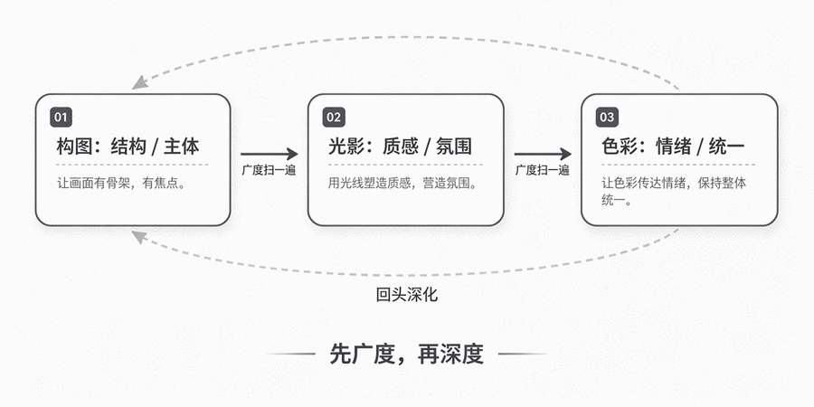

# 摄影学习路径

## 先说问题

"先学构图，再学光影，再学色彩"这句话没错，但原笔记后面又说"先粗略学光影色彩，再回头深化构图"，两段自相矛盾，读的人不知道该听哪句。

其实两句话说的是不同层面：

- **第一句是"知识结构"**：构图是骨架，光影是质感，色彩是情绪；
- **第二句是"学习节奏"**：不要在一个阶段死磕到完美，先广度扫一遍，再回头深化。

这一篇把两者整合成一条可执行的路径。

## 一、三个阶段，各解决什么问题

| 阶段 | 核心问题 | 主要手段 | 判断标准 |
|---|---|---|---|
| 构图 | 画面有没有结构、主体明不明确 | 机位、焦距、取景、减法 | 一眼能看出拍什么 |
| 光影 | 主体有没有立体感、画面有没有氛围 | 光位、光质、光比 | 明暗有层次，不"平" |
| 色彩 | 情绪对不对、色调统不统一 | 白平衡、HSL、调色 | 颜色不脏、不打架 |

### 1. 构图阶段（约 1–3 个月）

练什么：

- 三分、对称、引导线、框架、留白；
- 机位三坐标（高度、角度、距离）；
- 景别五档；
- 做减法：一张照片只留一个主体。

怎么练：

- 同一场景拍 10 张不同构图，选 1 张；
- 先拍静物/风景，排除"人"的干扰；
- 每天看 10 张好照片，只分析"主体在哪、视线往哪走"。

### 2. 光影阶段（约 2–4 个月）

练什么：

- 自然光：黄金时刻、阴天、窗光、逆光；
- 人造光：单灯方向、光质、光比；
- 观察阴影：阴影落在哪，脸就"长"成什么样。

怎么练：

- 同一场景早/中/晚各拍一次；
- 单灯 45°/90°/逆光各拍 10 张；
- 用反光板/闪光灯补光，体会光比。

### 3. 色彩阶段（持续）

练什么：

- 白平衡：K 值、偏移、混合光；
- 色彩关系：互补、邻近、冷暖对比；
- 调色流程：校正 → 影调 → 色彩 → 风格。

怎么练：

- 拍同一主体，换三种白平衡；
- 找参考图，反推它的白平衡/HSL/曲线；
- 一套图统一色调，而不是每张一个风格。

## 二、"先广度还是先深度"

两种学法都对，取决于你的目标：

| 学法 | 适合 | 优点 | 风险 |
|---|---|---|---|
| 先深化构图，再学光影色彩 | 想打扎实基础、拍纪实/风光 | 结构稳、不浮躁 | 容易"形式主义"，画面正确但没气氛 |
| 先粗略扫光影色彩，再回头深化构图 | 想快速出片、拍人像/商业 | 出片快、有氛围感 | 基础不牢，遇到复杂场景就乱 |

推荐做法：**先广度扫一遍（每样 2–4 周），再回到构图深化。**理由：

- 不懂光影，练构图容易停在"摆得对"而不是"感觉对"；
- 不懂色彩，构图会忽略"色块重量"；
- 但也不能一直扫，扫完必须回到结构，否则照片"有气氛没骨架"。

## 三、现场的三个循环

拍摄现场，三者不是严格先后，而是循环：

1. **构图定框架**：先决定拍什么、主体在哪；
2. **光影定质感**：看光从哪来，微调机位/人物位置；
3. **色彩定情绪**：看环境色、服装色，决定白平衡和后期方向。

经验法则：**先锁主体和结构，再微调光线和色彩。**结构一变，光和色都要重来。

## 四、进阶内容（基础之后）

- 镜头特性：焦段、畸变、透视压缩；
- 长曝光、HDR、堆栈；
- 闪光灯多灯布光；
- 色彩管理（sRGB/Adobe RGB/印刷）；
- 用照片讲故事（组照、编辑逻辑）。

## 五、一份 12 周计划

| 周 | 主题 | 产出 |
|---|---|---|
| 1–3 | 构图：三分/对称/引导线/留白 | 每周 1 组 10 张 |
| 4–5 | 机位与景别 | 同一人拍远/全/中/近/特 |
| 6–7 | 自然光：黄金时刻/阴天/窗光 | 同一场景三个时段 |
| 8–9 | 单灯：方向/光质/光比 | 每周 1 组对比 |
| 10 | 白平衡与偏移 | 同一场景 4 种白平衡 |
| 11 | 调色流程 | 1 组完整修图 |
| 12 | 综合创作 | 1 组 10–15 张主题作品 |

## 要点回顾

- 构图是骨架、光影是质感、色彩是情绪。
- 先广度扫一遍，再回头深化构图，避免形式主义。
- 现场是循环：结构 → 光线 → 色彩，结构优先。
- 每阶段用"作品"验收，不用"看过多少教程"。

> 参考：Bruce Barnbaum《The Art of Photography》；Michael Freeman《The Photographer's Eye》。
